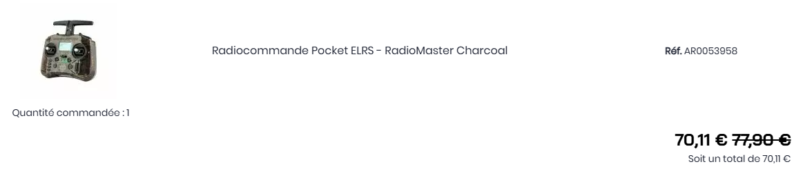
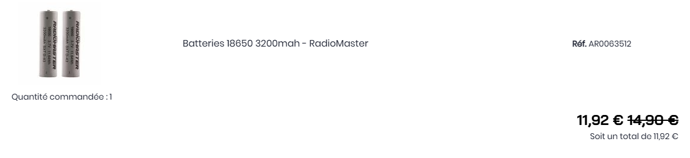
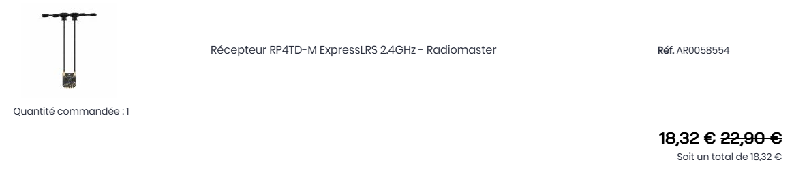
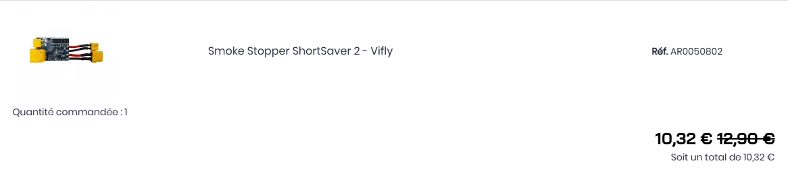
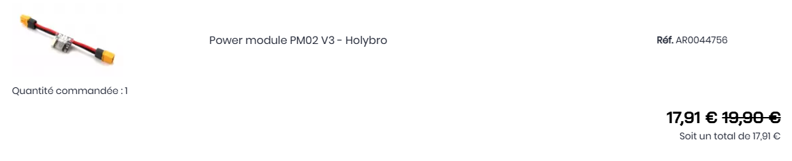
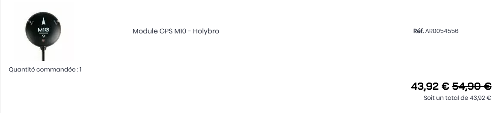
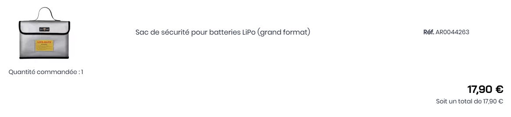
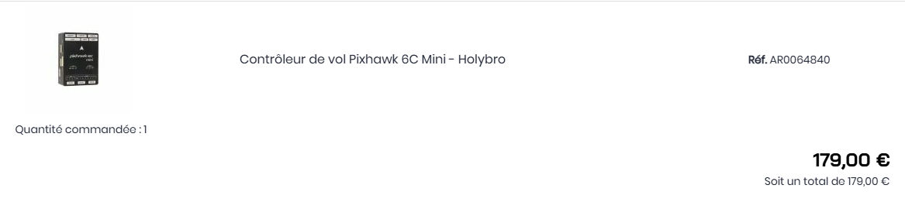
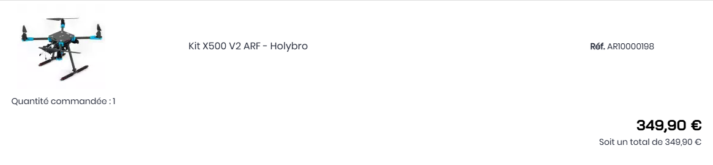

# Récapitulatif de l'équipement acheté — phase 1

[← Doc globale](README.md) · [Liste d'achat (BOM)](bom.md) · [Ordre d'achat](ordre-achat.md) · Issue [#6](https://github.com/HSSRD/Dragon/issues/6)

Ce document récapitule **tout ce qui a été acheté** pour la phase 1. Pour chaque équipement, il explique :
- à quoi il sert ;
- pourquoi on en a besoin ;
- pourquoi on a pris **lui** et pas un autre (le challenge).

Les fiches détaillées (options comparées, pièges, validation) sont dans [`achats/`](achats/).

---

## Sommaire

| # | Équipement | À quoi il sert | Prix payé |
|---|---|---|---|
| 1 | [Radiocommande RadioMaster Pocket ELRS](#1-radiocommande-radiomaster-pocket-elrs) | La manette : piloter le drone, l'armer, changer de mode, le couper en urgence. Sert aussi de manette pour le simulateur sur PC | 70,11 € |
| 2 | [Accus 18650 RadioMaster 3 200 mAh (×2)](#2-accus-18650-radiomaster-3-200-mah) | Les piles rechargeables de la radiocommande | 11,92 € |
| 3 | [Récepteur RadioMaster RP4TD-M ExpressLRS](#3-récepteur-radiomaster-rp4td-m-expresslrs) | Reçoit les ordres de la radiocommande à bord du drone et les transmet au contrôleur de vol | 18,32 € |
| 4 | [Smoke stopper Vifly ShortSaver 2](#4-smoke-stopper-vifly-shortsaver-2) | Coupe le courant en cas de court-circuit lors des premières mises sous tension | 10,32 € |
| 5 | [Module de puissance Holybro PM02 V3](#5-module-de-puissance-holybro-pm02-v3) | Alimente le contrôleur de vol en 5 V et mesure la tension et le courant de la batterie | 17,91 € |
| 6 | [GPS Holybro M10](#6-gps-holybro-m10) | Donne la position et le cap (boussole) du drone : maintien de position, retour automatique | 43,92 € |
| 7 | [Sac de sécurité LiPo (grand format)](#7-sac-de-sécurité-lipo-grand-format) | Contient un éventuel feu de batterie pendant la charge et le stockage | 17,90 € |
| 8 | [Contrôleur de vol Holybro Pixhawk 6C Mini](#8-contrôleur-de-vol-holybro-pixhawk-6c-mini) | Le cerveau du drone : lit les capteurs et stabilise le drone des milliers de fois par seconde | 179,00 € |
| 9 | [Kit Holybro X500 V2 ARF](#9-kit-holybro-x500-v2-arf) | Le drone lui-même : châssis carbone, 4 moteurs, 4 variateurs (ESC), carte de distribution, hélices | 349,90 € |
| | **Total** | | **719,30 € d'articles + 7,90 € de port = 727,20 €** |

| Commande | Date | Vendeur | Contenu | Total payé |
|---|---|---|---|---|
| [Panier A](commandes/2026-11-20-studiosport-panier-a.md) | 20/11/2026 | Studiosport | n° 1 à 7 | **190,40 €** (port offert) |
| [Panier B](commandes/2026-11-25-studiosport-panier-b.md) | 25/11/2026 | Studiosport | n° 8 et 9 | **536,80 €** (dont 7,90 € de port) |
| **Total** | | | | **727,20 €** sur un budget de 1 200 € |

### Comment tout s'assemble

```
Radiocommande Pocket ──(radio 2,4 GHz)──► Récepteur RP4TD-M ──► Pixhawk 6C Mini ◄── GPS M10
                                                                     │   ▲
                                                       sorties moteurs   │ 5 V + mesures
                                                                     ▼   │
Batterie LiPo 4S ──► [smoke stopper, 1ʳᵉˢ mises sous tension] ──► PM02 V3 ──► Carte de distribution du kit ──► 4 ESC ──► 4 moteurs
```

---

## Panier A — Studiosport, 20/11/2026


### 1. Radiocommande RadioMaster Pocket ELRS



| | |
|---|---|
| Référence | AR0053958 — coloris **Charcoal** |
| Lien | [studiosport.fr](https://www.studiosport.fr/radiocommande-pocket-elrs-radiomaster-a27235.html) |
| Prix | **70,11 €** au lieu de 77,90 € (promo Black Friday) |
| Fiche détaillée | [08 — Radiocommande](achats/08-radiocommande.md) |

**À quoi elle sert**
- Piloter le drone à la main.
- **La sécurité** : armer et désarmer les moteurs, changer de mode de vol, déclencher le retour automatique, **couper les moteurs en urgence**. C'est aussi elle qui reprendra la main si notre propre code fait n'importe quoi (phases 3 et suivantes).
- **Manette pour le simulateur** sur PC (branchée en USB) : on s'entraîne avant d'avoir le drone. Objectif : 5 h de simulateur avant le premier vol.

**Pourquoi on en a besoin**
Aucun vol n'est possible, ni légal, sans un moyen de reprendre la main et de couper les moteurs à tout moment.

**Pourquoi elle**
- **ExpressLRS (ELRS) 2,4 GHz intégré** : protocole ouvert, récepteurs à 20–30 €, lu nativement par ArduPilot, avec télémétrie (tension de la batterie affichée sur la radio).
- **Version européenne (LBT)**, puissance réglable : on la règle à **100 mW maximum**, la limite légale en France.
- **EdgeTX** : firmware ouvert et programmable (sécurisation de l'armement par interrupteurs logiques).
- **Assez d'interrupteurs** : 2 à deux positions, 2 à trois positions et un bouton. Affectation prévue : armement, modes de vol, retour maison, arrêt d'urgence des moteurs.
- Manches à **effet Hall**, qui ne s'usent pas.

**Challenge**
| Alternative | Pourquoi on ne l'a pas prise |
|---|---|
| RadioMaster Boxer (~180 €) | Meilleure en main (grands manches), mais **~110 € de plus**. Inutile pour apprendre |
| RadioMaster TX16S | Grand écran et bi-bande, mais plus lourde et encore plus chère. Le 900 MHz ne sert à rien en France (915 MHz y est illégal) |
| FrSky, Spektrum, Flysky, DJI | Protocoles fermés, récepteurs chers, moins bien intégrés à ArduPilot |
| Radio d'occasion | C'était l'achat d'occasion le plus pertinent, mais la promo neuve à 70 € réduisait beaucoup l'intérêt |

- **Point faible assumé :** les manches sont **petits et courts** : un peu moins de précision en stationnaire.
- **Ce qui ferait changer d'avis :** si les petits manches gênent vraiment au simulateur, passer à une Boxer. La Pocket restera alors une radio de secours.
- **À vérifier à la réception :** la mention **LBT / EU**. Elle avait été confirmée pour le coloris Transparent, pas pour le Charcoal.

### 2. Accus 18650 RadioMaster 3 200 mAh



| | |
|---|---|
| Référence | AR0063512 — lot de 2 |
| Lien | [studiosport.fr](https://www.studiosport.fr/batteries-18650-3200mah-radiomaster-a33732.html) |
| Prix | **11,92 €** au lieu de 14,90 € |

**À quoi ils servent** : alimenter la radiocommande. La Pocket utilise deux accus au format 18650.

**Pourquoi on en a besoin** : la Pocket est **livrée sans accus**. Sans eux, pas de radio, donc pas de simulateur.

**Pourquoi eux**
- Marque RadioMaster, accus **protégés** (circuit contre la décharge profonde et le court-circuit).
- Conseillés pour la Pocket par Oscar Liang, une référence du milieu.
- 3 200 mAh : environ 8 à 10 h d'autonomie de la radio.

**Challenge**
- **« Des 18650 génériques à 3 € pièce ? »** Beaucoup de 18650 bon marché ont une capacité gonflée ou sont des cellules recyclées. Dans une radio qui doit garder le drone sous contrôle, on ne prend pas ce risque pour 6 €.
- **« Des 18650 à fort courant (Molicel, Samsung) ? »** Inutile : une radio consomme peu. La capacité compte plus que le courant.
- **Incertain :** la Pocket ne figure pas dans la liste de compatibilité Studiosport de ces accus. Leurs dimensions (accus protégés, un peu plus longs) sont à vérifier en les insérant.

### 3. Récepteur RadioMaster RP4TD-M ExpressLRS



| | |
|---|---|
| Référence | AR0058554 |
| Lien | [studiosport.fr](https://www.studiosport.fr/recepteur-rp4td-m-expresslrs-24ghz-radiomaster-a30184.html) |
| Prix | **18,32 €** au lieu de 22,90 € |
| Fiche détaillée | [08 — Radiocommande](achats/08-radiocommande.md) |

**À quoi il sert** : à bord du drone, il reçoit les ordres de la radiocommande et les transmet au contrôleur de vol, en protocole CRSF sur un port série. En retour, il renvoie la télémétrie à la radio (tension de la batterie, qualité du lien).

**Pourquoi on en a besoin** : c'est la moitié « drone » de la liaison radio. La radio seule ne parle à rien.

**Pourquoi lui**
- **Vraie diversité** (*true diversity*) : deux antennes et deux récepteurs radio. Le récepteur garde le meilleur signal, même quand le drone tourne et qu'une antenne est masquée par le cadre carbone ou la batterie.
- Même marque et même protocole (ELRS) que la radio : appairage simple.
- Minuscule et léger.

**Challenge**
| Alternative | Pourquoi on ne l'a pas prise |
|---|---|
| RP4TD (version normale) | Télémétrie à 2 × 100 mW au lieu de 2 × 10 mW, mais **~10 € de plus**. En vol à vue (A3, quelques centaines de mètres), 10 mW de télémétrie suffisent |
| Récepteur ELRS simple antenne (EP1, EP2, ~12 €) | Moins cher, mais **une seule antenne** : risque de perte de signal selon l'orientation. Pour 6 € d'écart, on garde la diversité |
| Récepteur SBUS ou PPM | Pas de télémétrie, et le CRSF est mieux géré par ArduPilot |

- **Contrainte à connaître :** sous ArduPilot, le CRSF **ne passe pas par l'entrée RC** du Pixhawk. Le récepteur occupe un **port série** (TELEM1 prévu).
- **Soudure :** le récepteur se raccorde par ses pastilles. On soudera un câble JST-GH du Pixhawk *(câble fourni avec le récepteur à vérifier à réception)*.
- **Ce qui ferait changer d'avis :** des vols plus lointains (phases 4–5) qui demanderaient une télémétrie plus puissante.

### 4. Smoke stopper Vifly ShortSaver 2



| | |
|---|---|
| Référence | AR0050802 |
| Lien | [studiosport.fr](https://www.studiosport.fr/smoke-stopper-shortsaver-2-vifly-a25141.html) |
| Prix | **10,32 €** au lieu de 12,90 € |
| Fiche détaillée | [12 — Outillage](achats/12-outillage.md) |

**À quoi il sert** : il se branche entre la batterie et le drone lors des **premières mises sous tension**. S'il détecte un court-circuit (courant au-delà de 1 ou 2 A), il coupe en **3 millisecondes**, avant que quelque chose brûle.

**Pourquoi on en a besoin** : une soudure inversée ou un fil mal isolé se découvre au premier branchement. Sans protection, une LiPo délivre des dizaines d'ampères instantanément et peut détruire **~500 € d'électronique** (contrôleur de vol, ESC, récepteur). C'est une règle non négociable du projet ([CLAUDE.md](../../CLAUDE.md)).

**Pourquoi lui**
- **Caractéristiques publiées** : seuil de 1 ou 2 A, coupure en 3 ms.
- **Interrupteur intégré** : on peut couper sans débrancher.
- Prises **XT60 et XT30** : il convient à la batterie du drone et aux petits montages.

**Challenge**
| Alternative | Pourquoi on ne l'a pas prise |
|---|---|
| Smoke stopper Amass à ~3–5 € | **Aucune caractéristique publiée** (seuil, temps de coupure). On ne sait pas s'il protège vraiment |
| Fusible ou ampoule en série | Fonctionne, mais plus lent et plus artisanal |
| Alimentation de labo limitée en courant | Idéal, mais 50–100 € de plus |

- **Limite à connaître :** il ne sert **qu'au banc**. Il ne laisse pas passer le courant des moteurs : **on ne vole jamais avec**.

### 5. Module de puissance Holybro PM02 V3



| | |
|---|---|
| Référence | AR0044756 |
| Lien | [studiosport.fr](https://www.studiosport.fr/power-module-pm02-v3-holybro-a19717.html) |
| Prix | **17,91 €** au lieu de 19,90 € |
| Fiche détaillée | [06 — Puissance et BEC](achats/06-puissance-bec.md) |

**À quoi il sert**
1. **Alimenter le contrôleur de vol** : il fournit un 5 V propre (5,2 V, 3 A) à partir de la batterie 4S (16,8 V).
2. **Mesurer** la tension et le courant de la batterie. C'est ce qui permet au drone de savoir quand la batterie est faible et de **rentrer seul** avant qu'elle soit vide (failsafe batterie).

Il se place entre la batterie (XT60) et la carte de distribution du kit.

**Pourquoi on en a besoin** : sans mesure de la batterie, on vole à l'aveugle. Une LiPo vidée en vol, c'est une chute, et une batterie abîmée.

**Pourquoi lui**
- Format **Holybro / Pixhawk** : connecteur dédié, se branche directement sur le port POWER du Pixhawk, valeurs de calibration connues.
- 2 à 12S, 60 A en continu : ira aussi en 6S si on fait évoluer la motorisation.
- Prises XT60 déjà montées : **pas de soudure**.

**Challenge**
| Alternative | Pourquoi on ne l'a pas prise |
|---|---|
| PM06 (carte de distribution intégrée) | Le kit X500 a déjà sa carte de distribution : doublon |
| Module générique (APM) | Calibration inconnue, connecteur différent |

- **Point faible connu :** les **fils fournis** sont donnés pour 30 A en continu et 60 A en pointe. À plein gaz, le drone peut tirer ~65 A. Parade : plafonner la sortie moteur dans ArduPilot (`MOT_SPIN_MAX` ≈ 0,90, voir [fiche 02](achats/02-helices.md)) et contrôler la température des fils après les vols vifs.
- **Doublon :** le 6C Mini est livré avec un module de puissance *(lequel : à vérifier)*. Le PM02 du panier A devient alors **une pièce de rechange**. Il a été acheté quand le plan était le 6C standard, vendu sans module.
- **Ne pas faire :** alimenter le Raspberry Pi (phase 3) avec ce 5 V. Il faudra un BEC séparé de 5 V 5 A.

### 6. GPS Holybro M10



| | |
|---|---|
| Référence | AR0054556 |
| Lien | [studiosport.fr](https://www.studiosport.fr/module-gps-m10-holybro-a27639.html) |
| Prix | **43,92 €** au lieu de 54,90 € |
| Fiche détaillée | [09 — GPS](achats/09-gps.md) |

**À quoi il sert**
- **Position** : maintien de position (le drone reste immobile si on lâche les manches), **retour automatique** au point de décollage, missions par points de passage plus tard.
- **Boussole** intégrée : donne le cap du drone. Elle est montée en hauteur sur un mât, loin des câbles de puissance qui la perturbent.

**Pourquoi on en a besoin** : pour voler, un GPS n'est pas indispensable. **Pour la sécurité d'un débutant, il l'est** : en cas de perte radio ou de panique, le drone tient sa position ou rentre seul.

**Pourquoi lui**
- Puce **u-blox M10** récente : 4 constellations (GPS, Galileo, GLONASS, BeiDou), fix rapide.
- Connecteur **10 broches au standard Pixhawk** : branchement direct sur le port GPS1.
- Bouton de sécurité, buzzer et LED d'état intégrés.
- Boussole IST8310, reconnue partout.

**Challenge**
| Alternative | Pourquoi on ne l'a pas prise |
|---|---|
| Holybro Micro M10 (~28 $) | Plus petite antenne (fix plus lent), sans bouton ni buzzer. 15 € d'économie qui dégradent la sécurité |
| GPS « M10 » AliExpress à 15 € | Beaucoup de copies, avec une boussole mal orientée ou absente. Une mauvaise boussole fait tourner le drone en spirale en maintien de position |
| Matek M10Q | Arrêté par le fabricant |
| Deux GPS (redondance) | Utile pour les missions lointaines (phases 4–5), pas pour débuter |

- **À vérifier à la réception :** le modèle de boussole (IST8310 ou IST8308) et la présence du mât, fourni avec le GPS ou avec le kit.

### 7. Sac de sécurité LiPo (grand format)



| | |
|---|---|
| Référence | AR0044263 |
| Lien | [studiosport.fr](https://www.studiosport.fr/sac-se-securite-pour-batteries-lipo-grand-format-a19371.html) |
| Prix | **17,90 €** |
| Fiche détaillée | [10 — Chargeur](achats/10-chargeur.md) |

**À quoi il sert** : on y place les batteries LiPo **pendant la charge et le stockage**. Il est en tissu ignifugé et contient les flammes si une batterie s'emballe.

**Pourquoi on en a besoin** : une LiPo abîmée ou mal chargée peut prendre feu violemment, sans prévenir. Charger sous surveillance, dans un sac ignifugé, est une règle non négociable du projet.

**Pourquoi lui**
- **Grand format** (26 × 18 × 13 cm) : il contient deux ou trois packs 4S de 5 000 mAh (~139 × 44 × 36 mm chacun). Les petits formats ne contiennent qu'un pack.
- Poignée : on le sort vite de la pièce en cas de problème.

**Challenge**
| Alternative | Pourquoi on ne l'a pas prise |
|---|---|
| Petit sac (taille S) | Trop petit pour nos packs 4S |
| Boîte métallique type « Bat-Safe » (~60–100 €) | Plus sûre (évacue les gaz), mais 3 à 5 fois plus chère. À envisager si on accumule beaucoup de batteries |
| Boîte de munitions métallique | Courante chez les amateurs, mais une boîte **étanche** peut monter en pression : il faut la modifier. Moins simple |

- **Limite à connaître :** un sac **limite** les dégâts, il ne les empêche pas. Il se pose sur une surface non inflammable (carrelage, pierre), loin des rideaux, et **on ne laisse jamais une charge sans surveillance**.

---

## Panier B — Studiosport, 25/11/2026


### 8. Contrôleur de vol Holybro Pixhawk 6C Mini



| | |
|---|---|
| Référence | AR0064840 |
| Lien | [studiosport.fr](https://www.studiosport.fr/controleur-de-vol-pixhawk-6c-mini-holybro-a34703.html) |
| Prix | **179,00 €** |
| Fiche détaillée | [07 — Contrôleur de vol](achats/07-controleur-de-vol.md) *(rédigée avant le choix du Mini : à mettre à jour)* |

**À quoi il sert** : c'est le cerveau du drone.
- Il lit ses capteurs (2 accéléromètres et gyroscopes, baromètre), le GPS et la radio.
- Il calcule des milliers de fois par seconde la commande de chaque moteur pour **garder le drone stable**.
- Il exécute les modes de vol : stabilisé, maintien d'altitude, maintien de position, retour automatique.
- Il parle **MAVLink** avec Mission Planner (sur PC) et, en phase 3, avec le Raspberry Pi qui portera notre code.

On y installera **ArduPilot**, un logiciel de vol libre (voir [ADR-001](../decisions/ADR-001-architecture-logicielle.md)).

**Pourquoi on en a besoin** : un quadricoptère est instable par nature. Sans contrôleur de vol, aucun humain ne peut le faire tenir en l'air.

**Pourquoi lui**
- Processeur **STM32H743** à 480 MHz : le même que les Pixhawk plus chers.
- **Deux IMU** (ICM-42688-P et BMI088), **isolées des vibrations et chauffées** : des mesures propres et une redondance si un capteur défaille.
- Support **officiel** d'ArduPilot et de PX4, avec une documentation écrite pour cette carte.
- **Sorties moteurs intégrées** : les ESC se branchent directement, sans carte supplémentaire.
- Connecteurs **standard Pixhawk** (JST-GH) : le GPS M10 et le PM02 se branchent sans soudure.
- Standard ouvert : c'est aussi la cible de la **phase 6** (firmware maison).

**Challenge : pourquoi le Mini et pas le 6C standard ?**
C'était l'inverse dans le plan initial. Le choix a été retourné le 24/11/2026 après vérification.

| Critère | 6C standard | 6C Mini | Verdict |
|---|---|---|---|
| **Capteurs reconnus par ArduPilot** | Holybro livre une **nouvelle révision** (DSK320X + BMI423). Le **BMI423 n'a aucun pilote** dans ArduPilot, et le DSK320X n'est reconnu qu'en version de développement ([PR #34484](https://github.com/ArduPilot/ardupilot/pull/34484) ouverte au 24/11/2026). En version stable, aucune des deux IMU ne serait reconnue | ICM-42688-P + BMI088, reconnus en version stable | **Mini, et c'est l'argument décisif** |
| Ports série | 5 (dont TELEM3) | 4 | 6C, mais l'écart est rattrapable (voir plus bas) |
| Entrées d'alimentation | 2 (POWER1 + POWER2) | 1 | 6C, mais inutile sans second module de puissance |
| Sorties moteurs | 16, via une carte de sorties **vendue à part** avec le PM02 | 14, intégrées | Mini (on en utilise 4) |
| Prix total | 209 € + carte de sorties | 179 € | Mini |
| Disponibilité | Rupture | En stock | Mini |

- **Le port série en moins est rattrapable :**
  - GPS1 = GPS M10 ;
  - TELEM1 = récepteur ELRS ;
  - TELEM2 = Raspberry Pi (phase 3) ;
  - GPS2 = libre ;
  - les capteurs futurs iront de préférence en **I2C ou DroneCAN** (2 bus CAN disponibles), par exemple le Holybro H-Flow (flux optique + télémètre).
- **Problème signalé à surveiller :** des coupures de la mesure batterie en vol ont été rapportées sur le Mini avec un PM02 V3, **sous PX4** ([forum PX4](https://discuss.px4.io/t/pixhawk-6c-mini-battery-status-dropping-out-during-flight/48044)). Le signal en cause n'est pas utilisé par ArduPilot, et aucun retour équivalent n'a été trouvé sous ArduPilot. À contrôler au banc quand même.

| Autres alternatives | Pourquoi on ne les a pas prises |
|---|---|
| Carte FPV H743 (Matek, ~70–100 €) | Moins chère, mais IMU non chauffée et non isolée, soudures fines, connecteurs hors standard Pixhawk |
| Pixhawk 6X, Cube Orange+ (300–450 €) | Surdimensionnés pour ce projet |

- **Ce qui ferait changer d'avis :** un besoin d'au moins deux appareils série en plus du Pi, du GPS et de l'ELRS ; ou des coupures de mesure batterie reproduites sous ArduPilot.
- **Validation à la réception :** après le flash d'ArduPilot stable, **les deux IMU doivent être détectées**. Sinon, retour de la carte.

### 9. Kit Holybro X500 V2 ARF



| | |
|---|---|
| Référence | AR10000198 |
| Lien | [studiosport.fr](https://www.studiosport.fr/holybro-x500-v2-kit-arf/) |
| Prix | **349,90 €** |
| Fiches détaillées | [01 — Châssis](achats/01-chassis.md) · [02 — Hélices](achats/02-helices.md) · [03 — Moteurs](achats/03-moteurs.md) · [05 — ESC](achats/05-esc.md) · [ADR-003](../decisions/ADR-003-kit-arf-vs-piece-par-piece.md) |

**À quoi il sert** : c'est le drone lui-même, « presque prêt à voler » (ARF, *Almost Ready to Fly*) : il ne manque que l'électronique de commande (contrôleur de vol, GPS, récepteur) et la batterie.

| Contenu | Rôle |
|---|---|
| **Châssis carbone 500 mm** (tubes de 16 mm, plaques, train d'atterrissage) | La structure qui porte tout. L'empattement de 500 mm permet des hélices de 10" |
| **Rails de charge utile** (10 mm × 250 mm) | Fixer plus tard le Raspberry Pi, la caméra et les capteurs (phases 3–5) |
| **4 moteurs 2216 KV920** (T-Motor AIR2216 II) | Font tourner les hélices. **1 332 g de poussée chacun** à plein gaz en 4S |
| **4 ESC BLHeli_S 20 A** | Les variateurs : transforment l'ordre du contrôleur de vol en courant pour chaque moteur |
| **Carte de distribution** (XT60 batterie, XT30 vers les ESC) | Répartit le courant de la batterie vers les 4 ESC |
| **6 hélices 1045** | 4 montées + 2 de rechange |
| Sangles et support de batterie, visserie, outils | Montage sans soudure |

**Pourquoi on en a besoin** : c'est le cœur matériel du projet. Tout le reste s'y fixe.

**Pourquoi lui**
- **Propulsion assortie par le fabricant** : moteurs, ESC et hélices sont testés ensemble. On ne risque pas une erreur de dimensionnement à son premier drone.
- **Sans soudure** de puissance : adapté à quelqu'un qui soude « un peu ».
- **Rails pour la charge utile** : c'est ce qui le distingue du S500, pour les capteurs des phases suivantes.
- **Marge de poussée** : 4,8 kg utiles (hélices limitées à 1,2 kg chacune) pour un drone de ~1,5 kg en phase 1, soit un rapport poussée/poids d'environ 3. Il reste au-dessus de 2 avec ~0,5 kg de capteurs.
- Documentation PX4 et ArduPilot, standard du monde de la recherche.

**Challenge**
| Alternative | Pourquoi on ne l'a pas prise |
|---|---|
| **Holybro S500 V2 ARF** (même propulsion, ~170–200 €) | Moins cher et sans soudure, mais bras en nylon, **pas de rails** pour les capteurs. Choisi un temps quand le X500 était en rupture ([issue #3](https://github.com/HSSRD/Dragon/issues/3)), puis abandonné ([issue #4](https://github.com/HSSRD/Dragon/issues/4)) |
| Montage pièce par pièce (cadre ReadyToSky S500 + moteurs et ESC Holybro, ~285 €) | ~65 € de moins, mais cadre générique en plastique, ~12 soudures de puissance, pas de rails. Le cadre X500 seul n'est pas vendu en Europe |
| Kits génériques Amazon / AliExpress (F450, S500 à 100–150 €) | Moteurs 2212 bas de gamme, ESC SimonK qui ne gèrent pas le DShot. Qualité inégale |
| Holybro X650 (~810–860 €) | Pour des charges de 1,5 kg et plus, en 6S. Hors budget, inutile en phase 1 |
| Holybro en direct (329 $ HT) | Avec le port, la TVA et les frais de dédouanement : ~430–475 €, et un SAV en Chine |
| Elektor, mybotshop (379,95 €) | 30 € de plus, et en précommande (de 3 semaines à 3 mois) |

- **Points faibles connus :**
  - **ESC 20 A** : un peu justes à plein gaz (16,4 A par moteur). Parade : plafonner les gaz (`MOT_SPIN_MAX` ≈ 0,90), puis flasher les ESC en **Bluejay** pour activer le filtrage RPM ([fiche 05](achats/05-esc.md)).
  - **Hélices limitées à 1,2 kg** de poussée, alors que le moteur peut en fournir 1,33 kg.
  - **« 1 500 g de charge utile »** annoncés par Holybro : argument commercial. On retient **~1 kg maximum**.
- **Ce qui ferait changer d'avis :** une charge utile visée au-delà de ~1 kg (lidar 3D, nacelle, Jetson) → passer en 6S ou à un châssis de 650 mm. Le Pixhawk, le GPS, la radio et le PM02 seraient réutilisés.
- **À vérifier à la réception :** le **KV des moteurs** (Studiosport annonce KV880, Holybro KV920), la présence du mât GPS, et le poids du kit monté.

---

## Ce qu'il reste à acheter pour voler

Détail, prix et challenge : [ordre d'achat](ordre-achat.md) et [bom.md](bom.md).

| Équipement | À quoi il sert | Prix estimé *(à vérifier)* |
|---|---|---|
| 2 batteries LiPo 4S 5 000–5 500 mAh, prise XT60 | L'énergie du drone | ~136 € |
| Chargeur ToolkitRC M6AC | Charger et équilibrer les LiPo | ~63 € |
| Testeur LiPo | Contrôler chaque cellule avant le vol | ~6 € |
| Hélices Holybro 1045 (1 lot de 4) | Rechange pour les premiers vols | ~16 € |
| Balise de signalement Dronavia Beacon AM | **Obligatoire** au-dessus de 800 g (format français) | 40 € |
| Consommables : frein-filet, étain, flux, gaine | Montage et soudure du récepteur | ~20–30 € |
| **Total restant** | | **~280–300 €**, soit **~1 010–1 030 €** pour la phase 1 |
